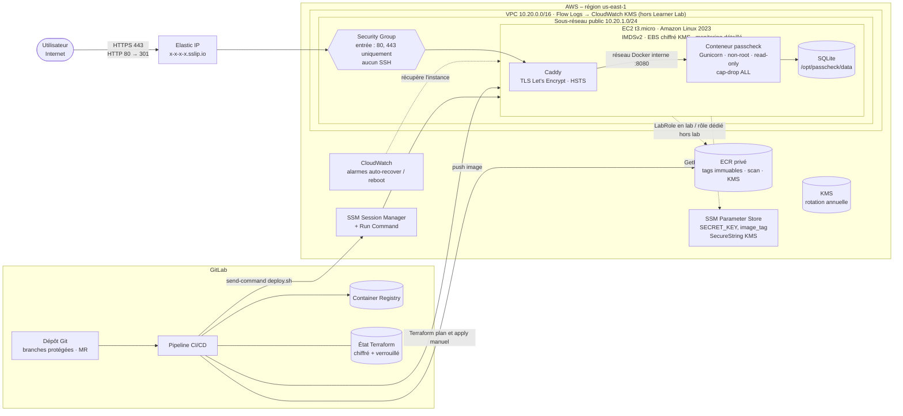

# PassCheck – Application Python sécurisée dans une pipeline DevSecOps

PassCheck est une application web Flask qui :

- vérifie si un mot de passe figure parmi les plus courants (listes SecLists) ;
- permet de créer un compte et de se connecter, avec **stockage sécurisé des mots de passe (Argon2id)**.

Elle est construite, testée, analysée et déployée sur **AWS** par une pipeline **GitLab CI/CD** avec des contrôles bloquants selon les seuils définis et des rapports de synthèse automatiques. Le projet est un démonstrateur pédagogique, pas une certification de sécurité.

| | |
|---|---|
| URL de production | `https://<ip-avec-tirets>.sslip.io` (affichée par `terraform output app_url` et dans **Operate → Environments**) |
| Stack | Python 3.12 · Flask 3.1 · Gunicorn · SQLite · Docker · Caddy · Terraform · AWS (EC2, ECR, SSM, KMS, CloudWatch) |
| Équipe | Imelda et Aboubakary — voir [`CONTRIBUTING.md`](CONTRIBUTING.md) |
| Dernière validation de référence | [Pipeline main #3113918874](https://gitlab.com/aboubakary/passcheck/-/pipelines/3113918874), commit `11048eb9`, 25/11/2026 : 20/20 jobs suivis réussis |
| Revue de code | [Merge Request !3](https://gitlab.com/aboubakary/passcheck/-/merge_requests/3), approuvée et fusionnée |

> L'URL publique exacte reste à renseigner après confirmation par le responsable AWS. Le smoke test HTTPS de la pipeline de référence est réussi.

---

## 1. Architecture cible



### Choix d'architecture et justification

| Choix | Pourquoi |
|---|---|
| **EC2 + Docker** derrière **Caddy** | Simple et maîtrisé dans une sandbox. Caddy gère le **TLS automatique** (Let's Encrypt), la redirection HTTP → HTTPS et HSTS. |
| **sslip.io** | Nom de domaine gratuit dérivé de l'Elastic IP : il permet d'obtenir un vrai certificat TLS sans acheter de domaine. |
| **Aucun port SSH**, administration par **SSM Session Manager** | Surface d'attaque réduite, aucune clé SSH à gérer, les appels d'administration peuvent être audités via CloudTrail. |
| **ECR + rôle IAM** pour tirer l'image | Aucun identifiant de registre stocké sur la machine : le rôle de l'instance suffit. |
| **Secrets dans SSM Parameter Store** (SecureString, KMS) | Ni dans le code, ni dans l'image, ni dans le *user data*. Ils sont lus au démarrage du conteneur. |
| **IMDSv2 obligatoire, hop limit 1** | Réduit le risque d'accès aux identifiants IAM via SSRF ; le hop limit à 1 limite l'accès IMDS depuis les conteneurs en réseau bridge. |
| **KMS dédié** (EBS, ECR, SSM, logs) avec rotation | Chiffrement au repos maîtrisé, et révocable. |
| **VPC Flow Logs → CloudWatch** (chiffré KMS, rétention 1 an) | Détection et investigation d'incidents. Désactivés en Learner Lab : voir la ligne suivante et le §8. |
| **État Terraform dans GitLab** | Chiffré, verrouillé pendant les `apply`, accessible selon les rôles. Pas de `.tfstate` dans Git. |
| **Compatibilité AWS Academy Learner Lab** (`use_lab_role = true`) | Le Learner Lab interdit `iam:CreateRole`. L'instance utilise donc `LabInstanceProfile` (vérifié : `LabRole` accepte `ec2.amazonaws.com`, mais pas `vpc-flow-logs.amazonaws.com`). Les Flow Logs sont désactivés en lab : CloudWatch est impossible faute de rôle, et S3 aussi, car une **SCP AWS Academy interdit `s3:GetBucketObjectLockConfiguration`**, que Terraform appelle après chaque création de bucket (erreur `explicit deny in a service control policy` observée au premier `infra_apply`). Les rôles au moindre privilège restent dans le code et sont créés automatiquement sur un vrai compte (`use_lab_role = false`). |
| **SQLite** sur volume hôte | Suffisant pour la charge du projet, sans coût ni service à exposer. *Limite :* il n'y a qu'une seule instance (voir §8). |

### Résilience

Les mécanismes ci-dessous sont prévus par l'infrastructure ; les essais de panne et de restauration n'ont pas été documentés dans les preuves disponibles. Il ne s'agit pas d'une architecture haute disponibilité.

- **Redémarrage automatique** : `--restart unless-stopped` sur les conteneurs, et un `HEALTHCHECK` dans l'image.
- **Auto-recovery EC2** : une alarme CloudWatch sur `StatusCheckFailed_System` déclenche `ec2:recover`, et une autre sur `StatusCheckFailed_Instance` déclenche un reboot.
- **Redéploiement au démarrage** : un service systemd relance `deploy.sh`, qui récupère la version courante dans SSM.
- **Elastic IP** : l'URL peut rester la même si l'Elastic IP est conservée et réassociée.
- **Infrastructure immuable** : l'infrastructure est décrite par Terraform et chaque image applicative est identifiée par le SHA court de son commit. Un retour arrière manuel est possible en principe en redéployant un tag ECR encore disponible ; il n'est pas automatisé ni testé dans les preuves fournies.
- **Limites de ressources** sur les conteneurs (mémoire, CPU, PIDs) : ces limites réduisent le risque d'épuisement des ressources de l'hôte.

---

## 2. Cycle de vie sécurisé (pipeline)

```mermaid
<<<<<<< Updated upstream
flowchart TD
    DEV["Développeur : branche feature/*"] --> MR["Merge Request : CI et revue"]
    MR --> L["lint : flake8, hadolint, Terraform, wordlists"]
    L --> S["security : Gitleaks, Bandit, Semgrep, pip-audit, Trivy FS, Checkov"]
    S --> T["test : 17 tests Pytest"]
    T --> B["build : image taggée SHA"]
    B --> IT["image-test : non-root, health, en-têtes"]
    IT --> IS["image-scan : Trivy et SBOM"]
    IS --> R["report : HTML et JSON"]
    R --> M{"Branche main ?"}
    M -->|Non| FIN["Fin CI / revue puis fusion si validée"]
    FIN -. Nouvelle pipeline main .-> L
    M -->|Oui| P["infra : plan puis apply manuel"]
    P --> PUB["publish : ECR"]
    PUB --> D["deploy : SSM Run Command"]
    D --> V["verify : HTTPS puis OWASP ZAP"]
    V --> F["final-report : rapport CI/CD"]
    S -. Échec : étapes normales bloquées .-> R
    P -. Échec : rapport partiel .-> F
=======
flowchart LR
    DEV[Développeur<br/>branche feature/*] -->|push| MR[Merge Request<br/>revue + approbation]
    MR --> L[lint<br/>flake8 · hadolint<br/>terraform validate<br/>intégrité wordlists]
    L --> S[security<br/>gitleaks · bandit · semgrep<br/>pip-audit · trivy fs · checkov]
    S --> T[test<br/>pytest 18 tests]
    T --> B[build<br/>image taggée SHA]
    B --> IT[image-test<br/>run durci · non-root<br/>health · headers]
    IT --> IS[image-scan<br/>trivy image · SBOM]
    IS -->|merge sur main| P[infra<br/>plan → apply manuel]
    P --> PUB[publish<br/>ECR immuable]
    PUB --> D[deploy<br/>SSM Run Command]
    D --> V[verify<br/>smoke test HTTPS<br/>DAST OWASP ZAP]
>>>>>>> Stashed changes
```

Le schéma représente le flux logique. Les jobs de reporting utilisent `when: always` pour conserver les preuves disponibles même en cas d'échec. Les dépendances `needs` de GitLab peuvent permettre à certains jobs de démarrer indépendamment de la fin d'un stage ; le rapport n'est pas un contrôle de sécurité supplémentaire.

| Étape | Outil | Ce qui est vérifié | Bloquant |
|---|---|---|---|
| lint | flake8 | Qualité et syntaxe Python (PEP 8) | ✅ |
| lint | hadolint | Bonnes pratiques du Dockerfile | ✅ |
| lint | `sha256sum -c` | Intégrité des listes de mots de passe embarquées | ✅ |
| lint | `terraform validate` | Syntaxe et cohérence de l'IaC | ✅ |
| security | **gitleaks** | Secrets dans **tout l'historique** Git | ✅ |
| security | **bandit** | SAST spécifique à Python | ✅ |
| security | **semgrep** | SAST multi-règles (python, flask, secrets, dockerfile) | ✅ |
| security | **pip-audit** | CVE des dépendances Python (SCA) | ✅ |
| security | **trivy fs** | CVE et secrets dans le dépôt | ✅ HIGH/CRITICAL |
| security | **checkov** | Terraform, Dockerfile et `.gitlab-ci.yml` (IaC) | ✅ |
<<<<<<< Updated upstream
| test | **pytest** | 17 tests fonctionnels **et de sécurité** (CSRF, injection SQL, brute force, énumération, hachage…) | ✅ |
=======
| test | **pytest** | 18 tests fonctionnels **et de sécurité** (CSRF en HTTP et HTTPS, injection SQL, brute force, énumération, hachage…) | ✅ |
>>>>>>> Stashed changes
| build | docker | Image construite, taggée avec le **SHA du commit** et poussée dans le registry GitLab | ✅ |
| image-test | docker | L'image démarre **avec les restrictions de production** (read-only, cap-drop ALL, no-new-privileges), répond sur `/health`, tourne en UID 10001 | ✅ |
| image-scan | **trivy image** | Rapport JSON de toutes les sévérités + SBOM CycloneDX | ✅ HIGH/CRITICAL avec correctif identifié (`--ignore-unfixed`) |
| report | Python + defusedxml | Synthèse HTML et JSON des 14 jobs CI | Exécuté même en cas d'échec |
| infra | terraform | `plan`, puis `apply` **manuel** (validation humaine avant la production) | ✅ |
| publish | ECR | Copie de l'image testée vers ECR, tags **immuables** | ✅ |
| deploy | SSM | Mise à jour du tag dans SSM, puis `deploy.sh` exécuté par Run Command (sans SSH) | ✅ |
| verify | curl | Santé en HTTPS, HSTS, redirection HTTP → HTTPS | ✅ |
| verify | **OWASP ZAP** | DAST baseline : scan passif, les WARN ne font pas échouer le job (`-I`) | ✅ FAIL |
| final-report | Python + defusedxml | Synthèse HTML et JSON des 20 jobs CI/CD sur main, hors destruction | Exécuté même en cas d'échec |

**Principe de promotion :** la pipeline construit une image taggée avec le SHA court du commit, la teste, la scanne, puis la copie du registre GitLab vers ECR sans reconstruction. Une vérification cryptographique du digest au déploiement reste une amélioration possible.

### Rapports automatiques et preuves

| Job | Périmètre | Artefacts |
|---|---|---|
| `security_report` | 14 jobs CI avant déploiement | `ci-report/report.html`, `ci-report/summary.json` |
| `deployment_report` | 20 jobs CI/CD sur `main` | `deployment-report/report.html`, `deployment-report/summary.json` |
| `image_scan` | Inventaire et analyse de l'image | `sbom.cdx.json`, `trivy-image.json` |
| `dast_zap` | Analyse dynamique | `zap-report.html`, `zap-report.json` |

Le script [`scripts/generate_security_report.py`](scripts/generate_security_report.py) consolide les statuts `CI_JOB_STATUS` enregistrés dans `after_script` et les résultats JSON/JUnit. Les XML sont analysés avec `defusedxml==0.7.1` et les DTD sont interdites. Les valeurs provenant des rapports sont échappées pour le HTML. Une preuve absente est marquée « Non confirmé / non exécuté », jamais comme un succès. Le statut final du job reste celui de GitLab.

Les rapports de synthèse sont conservés comme artefacts pendant 30 jours. Certains rapports bruts expirent au bout d'une semaine. Après une relance d'un job amont, il peut être nécessaire de relancer uniquement le job de synthèse pour actualiser son contenu. Ne pas confondre un rapport historique avec l'état courant de la pipeline.

---

## 3. Sécurisation du code source

### Vulnérabilités de l'application d'origine (`_original_app/`)

| # | Constat | Détecté par | Risque | Correction |
|---|---|---|---|---|
| 1 | **Flask 2.2.2** : CVE-2023-30861 (PYSEC-2023-62, fuite de cookie de session via cache) et PYSEC-2026-2151 | pip-audit | Vol de session | Flask **3.1.3**, versions figées |
| 2 | `requests.get()` **sans timeout** (×2) | bandit **B113** | Déni de service | Plus aucun appel réseau à l'exécution (listes embarquées) |
| 3 | `app.run(host='0.0.0.0')` : **serveur de développement** exposé | bandit **B104** | Serveur non prévu pour la production | **Gunicorn** derrière Caddy, conteneur isolé |
| 4 | Recherche de **sous-chaîne** dans `str(bytes)` | revue de code | Faux positifs (« a » considéré comme faible) : contrôle non fiable | Comparaison **exacte** dans un `frozenset` |
| 5 | Listes téléchargées depuis la branche **`master`** à chaque requête | revue de code | Supply chain (contenu modifiable), panne si GitHub est indisponible, lenteur | Listes **figées sur un commit**, embarquées, **empreinte SHA-256 vérifiée en CI** |
| 6 | `requests` **absent** de `requirements.txt` | revue / test | L'application plante au premier POST (disponibilité) | Dépendance supprimée |
| 7 | `<input type="text">` pour le mot de passe | revue de code | Mot de passe visible à l'écran | `type="password"`, `autocomplete="off"` |
| 8 | Formulaire codé en dur sur `http://localhost:8080` | revue de code | Ne fonctionne pas en ligne, envoi **en clair** | URL relative `url_for()`, HTTPS seulement |
| 9 | **Aucune protection CSRF** | revue de code | Requêtes forgées depuis un autre site | **Flask-WTF CSRFProtect** sur tous les POST |
| 10 | Aucune limite de taille ni de débit | revue de code | DoS, brute force | `MAX_CONTENT_LENGTH` 16 Ko, **Flask-Limiter** (5/min sur login et inscription) |
| 11 | Aucun en-tête de sécurité | ZAP / revue | XSS, clickjacking, sniffing MIME | CSP stricte, X-Frame-Options, nosniff, Referrer-Policy, HSTS (Caddy) |
| 12 | 74 erreurs de style | flake8 | Code difficile à relire | Code conforme (0 erreur) |

### Corrections complémentaires après l'audit du binôme

| Constat | Correction | Preuve |
|---|---|---|
| Troncature silencieuse du mot de passe de connexion à 128 caractères | Rejet explicite des entrées trop longues, sans troncature | `e996cbb` : test de non-régression, échec reproduit avant correction puis succès |
| Gunicorn à deux workers avec limiteur en mémoire ; erreur de socket de contrôle sur FS read-only | Un worker, deux threads, `--no-control-socket` | `819712b` : démarrage local sans l'erreur, test de débit local V2 (5 réponses 401 puis 2 réponses 429) |
| Image Debian 12 avec occurrences HIGH/CRITICAL | Migration vers Debian 13 et mise à jour ciblée de `libzstd1` | `819712b` : scans locaux avant/après et Trivy CI |
| Parseur XML standard dans le générateur de rapports | `defusedxml`, refus des DTD, gestion des exceptions | `793fc3e` : Semgrep bloquant sur #3113725167 puis pipeline #3113820235 réussie |

### Mesures transverses

- **Configuration par variables d'environnement.** L'application **refuse de démarrer** en production si `SECRET_KEY` est absente.
- **Cookies de session** `Secure`, `HttpOnly` et `SameSite=Lax`, d'une durée de 30 minutes. La session est vidée puis recréée côté application à la connexion (`session.clear()`).
- **Requêtes SQL paramétrées** exclusivement. Un test vérifie que l'injection `' OR '1'='1` échoue.
- **Pages d'erreur génériques** : aucune trace d'erreur (*stack trace*) n'est exposée.
- **Le mot de passe n'est jamais journalisé ni renvoyé** dans une page (vérifié par un test).

---

## 4. Stockage sécurisé des mots de passe

| Mesure | Détail |
|---|---|
| **Argon2id** (`argon2-cffi`) | Algorithme de hachage de mots de passe à coût mémoire, décrit dans la RFC 9106. Profil par défaut : t=3, m=64 Mio, p=4. Coûteux en mémoire, donc résistant aux attaques par GPU ou ASIC. |
| **Sel aléatoire** par mot de passe | Deux hachages du même mot de passe sont différents, ce qui rend les tables précalculées inutiles. |
| **Re-hachage automatique** | Si les paramètres sont renforcés, le hash est mis à jour à la connexion suivante (`check_needs_rehash`). |
| **Politique locale de mots de passe** | 12 caractères minimum et 128 maximum (anti-DoS). Cette politique est un choix du projet, pas une affirmation de conformité intégrale à NIST SP 800-63B. Interdiction des mots de passe présents dans les listes SecLists, et de ceux qui contiennent l'identifiant. |
| **Anti-énumération** | Message d'erreur identique, et **vérification d'un hash factice** quand le compte n'existe pas, pour réduire les différences de temps de réponse entre comptes existants et inexistants. |
| **Anti brute force** | 5 tentatives par minute et par IP sur la connexion et l'inscription, derrière Caddy avec `ProxyFix`. Compteur en mémoire, réinitialisé au redémarrage ; pas de partage entre instances. |
| **Base de données** | SQLite sur un volume chiffré (EBS KMS), répertoire en mode `0700` appartenant à l'UID 10001. |

Exemple de valeur stockée : `$argon2id$v=19$m=65536,t=3,p=4$<sel>$<hash>`. Le mot de passe en clair n'est jamais conservé.

---

## 5. Sécurité de l'image et de l'exécution

- **Build multi-stage**, base `python:3.12-slim-trixie` (Debian 13, builder et runtime, tag non épinglé par digest), **sans outils de compilation** dans l'image finale.
- **Gunicorn** : un worker et deux threads, socket de contrôle désactivé pour le système de fichiers en lecture seule ; cette configuration évite la dispersion du limiteur en mémoire entre plusieurs workers.
- **Mise à jour système ciblée** : `libzstd1=1.5.7+dfsg-1+deb13u1` dans l'image runtime (à surveiller lors des mises à jour des dépôts).
- **Utilisateur non-root** (UID 10001, shell `nologin`). Le code appartient à root : l'application ne peut pas se modifier elle-même.
- **Exécution durcie** : `--read-only`, `/tmp` en tmpfs `noexec`, `--cap-drop ALL`, `no-new-privileges`, limites de mémoire, de CPU et de PIDs.
- **HEALTHCHECK** intégré à l'image, utilisé par la pipeline et par `deploy.sh`.
- **SBOM CycloneDX** produit à chaque build (artefact `sbom.cdx.json`).
- **ECR** : scan à la publication, tags **immuables**, cycle de vie limité aux 10 dernières images.

---

## 6. Gestion des secrets

| Secret | Où il est stocké | Qui y accède |
|---|---|---|
| Identifiants AWS de la sandbox | Variables CI/CD GitLab **Protected + Masked** | Jobs des branches protégées uniquement |
| `SECRET_KEY` Flask | SSM SecureString (KMS), générée par Terraform | Rôle IAM de l'instance |
| État Terraform | Backend HTTP GitLab (chiffré, verrouillé) | Maintainers |
| Jeton du registry GitLab | `CI_REGISTRY_PASSWORD`, éphémère, propre au job | Le job uniquement |

**Gitleaks analyse tout l'historique** à chaque pipeline. Le `.gitignore` exclut les fichiers `.env`, `*.tfstate`, `*.tfvars` et `*.db`.

---

## 7. Versioning et collaboration

Les règles complètes sont dans [`CONTRIBUTING.md`](CONTRIBUTING.md). En résumé :

- **GitLab Flow** : `main`, toujours déployable et **protégée** ; les branches `feature/*`, `fix/*` et `infra/*` se fusionnent par **Merge Request**.
- **Règle de travail :** pas de push direct sur `main` ; fusion après pipeline verte, revue par un autre membre et résolution des discussions. La MR !3 illustre cette procédure ; GitLab affichait l'approbation comme facultative, mais elle a effectivement été donnée avant la fusion.
- **Séparation des responsabilités :** Imelda développe et soumet la MR ; Aboubakary approuve et fusionne sur `main` et gère le déploiement AWS. Les rôles et réglages exacts restent à vérifier dans le projet.
- **CODEOWNERS** : fichier de référence dans `.gitlab/CODEOWNERS` ; vérifier que les règles d'approbation sont effectivement imposées.
- **Commits** au format *Conventional Commits* (`feat:`, `fix:`…). Signature SSH/GPG, releases SemVer, 2FA et jetons à portée minimale : règles recommandées, application effective non vérifiée ici.

### Contributions et traçabilité

| Membre | Contributions |
|---|---|
| Imelda | Audit applicatif, correction de l'authentification, tests, durcissement Docker/Gunicorn, Trivy, rapport automatique et correction XML |
| Aboubakary | Mise en place initiale du projet, infrastructure Terraform/AWS, CI/CD cloud, adaptation Learner Lab, revue et fusion de la MR !3, déploiement |
| Ensemble | Validation, documentation et préparation de la soutenance |

Commits d'Imelda : `e996cbb` (authentification), `819712b` (Docker), `7f8fa2a` (reporting), `793fc3e` (XML). La MR !3 a été approuvée et fusionnée par Aboubakary dans `main` au commit `11048eb9`, sans squash ni suppression de la branche source. La [pipeline de branche #3113820235](https://gitlab.com/aboubakary/passcheck/-/pipelines/3113820235) et la [pipeline MR #3113861230](https://gitlab.com/aboubakary/passcheck/-/pipelines/3113861230) sont réussies.

---

## 8. Limites et améliorations prévues

| Limite actuelle | Amélioration |
|---|---|
| Une seule instance, dans une seule AZ | Auto Scaling Group sur 2 AZ derrière un **ALB + ACM + AWS WAF** |
| SQLite local | **RDS PostgreSQL** Multi-AZ en sous-réseau privé, chiffré, avec sauvegardes automatiques |
| Pas de sauvegarde automatique du volume | Politique **AWS Backup / DLM** (snapshot quotidien) |
| Pas de VPC Flow Logs en Learner Lab (rôle et SCP restrictifs) | Activés automatiquement sur un vrai compte (`use_lab_role = false`) |
| `LabRole` imposé par le Learner Lab : ses droits sont plus larges que notre rôle sur mesure | Sur un vrai compte : `use_lab_role = false`, qui active les rôles dédiés (ECR en lecture seule, 2 paramètres SSM, déchiffrement KMS) |
| Clés AWS de sandbox dans GitLab | Fédération **OIDC GitLab → AWS** (jetons éphémères, aucune clé stockée) |
| Images de base figées par tag | Épinglage par **digest** + mises à jour automatiques (Renovate) |
| Images non signées | Signature **Cosign** et vérification au déploiement |
| Limiteur de débit en mémoire (un worker actuellement) | Stockage Redis partagé et persistant |
| 53 occurrences HIGH sans correctif identifié lors du scan de référence | Surveillance des avis Debian, rebuild et revue régulière des risques |
| 1 groupe d'alertes ZAP de risque moyen et 4 informatifs | Récupérer le rapport DAST détaillé, analyser et corriger ou justifier |
| Pas de rollback automatique ; interruption possible durant le remplacement du conteneur | Déploiement blue/green, contrôle de santé avant bascule et rollback testé |
| SQLite sur disque racine de l'instance (suppression possible lors du remplacement) | Volume persistant indépendant, snapshots et test de restauration |
| Session AWS Academy temporaire | Renouveler les identifiants et coordonner les démonstrations avec la durée du lab |

---

## 9. Mise en route

### Prérequis (par le Maintainer ; identifiants AWS à renouveler à chaque session)

1. **Settings → CI/CD → Variables**, chacune en **Protected** et **Masked** : `AWS_ACCESS_KEY_ID`, `AWS_SECRET_ACCESS_KEY`, `AWS_SESSION_TOKEN`, `AWS_DEFAULT_REGION` (par exemple `us-east-1`). Les identifiants de sandbox expirent : il faut les mettre à jour à chaque nouvelle session.
2. **Settings → Repository → Protected branches** : `main`, avec *Allowed to push* = **No one** et *Allowed to merge* = Maintainers ou membres explicitement autorisés ; vérifier les réglages réels du projet.
3. **Settings → Merge requests** : cocher *Pipelines must succeed* et *All threads must be resolved*.

### Développement local

```bash
python3 -m venv .venv && source .venv/bin/activate
pip install -r requirements-dev.txt
APP_ENV=development DB_PATH=./dev.db flask --app "app.main:create_app()" run --port 8080
python -m pytest
```

### Développement local sous Windows (PowerShell)

```powershell
python -m venv .venv
.\.venv\Scripts\Activate.ps1
python -m pip install -r requirements-dev.txt
$env:APP_ENV = "development"
$env:DB_PATH = "./dev.db"
python -m flask --app "app.main:create_app()" run --port 8080
```

Dans un autre terminal, avec l'environnement virtuel activé : `python -m pytest -v` et `python -m flake8 app tests`.

### Avec Docker

```bash
docker build -t passcheck .
docker run --rm -p 127.0.0.1:8080:8080 --read-only --tmpfs /tmp --cap-drop ALL --security-opt no-new-privileges:true \
  -e SECRET_KEY="$(openssl rand -hex 32)" -e APP_ENV=development passcheck
```

### Déploiement

1. Fusionner une MR sur `main`.
2. Dans la pipeline, lancer le job manuel **`infra_apply`**. La publication, le déploiement, le smoke test et le DAST s'enchaînent ensuite automatiquement.
3. L'URL s'affiche dans **Operate → Environments → production**.
4. Vérifier le résultat de `deployment_report` et télécharger les artefacts HTML et JSON.
5. En cas de refus `voc-cancel-cred`, le responsable AWS démarre une session Learner Lab autorisée, renouvelle les trois identifiants temporaires dans GitLab et relance `infra_plan`. Après la réussite des étapes cloud, actualiser `deployment_report` si nécessaire.
6. **Destruction :** `infra_destroy` est réservé au responsable AWS lorsque la démonstration est terminée et les données/preuves sauvegardées. Cette action supprime les ressources gérées par Terraform ; ne pas l'exécuter pour actualiser un rapport.

---

## 10. Résultats de validation du 25 novembre 2026

Source : rapport automatique CI/CD de la [pipeline #3113918874](https://gitlab.com/aboubakary/passcheck/-/pipelines/3113918874), branche `main`, commit `11048eb91cf6b23089766e8320e4cd8d62a8a501`, généré à 14:17:30 UTC après relance du rapport.

| Indicateur | Résultat |
|---|---:|
| Jobs suivis réussis / total | **20 / 20** |
| Jobs suivis en échec / non confirmés | 0 / 0 |
| Pytest | 17 réussis / 17 |
| Gitleaks | 0 détection |
| Bandit / Semgrep | 0 / 0 détection |
| pip-audit | 20 dépendances analysées, 0 vulnérabilité détectée |
| Checkov | 232 cas JUnit, 228 réussis, 4 ignorés, 0 échec et 0 erreur |
| Trivy image : CRITICAL / HIGH / MEDIUM / LOW / UNKNOWN | 0 / 53 / 86 / 79 / 18 |
| Trivy : occurrences totales / identifiants distincts | 236 / 106 |
| Trivy : HIGH/CRITICAL avec version corrigée identifiée | 0 |
| SBOM CycloneDX | 111 composants |
| AWS : plan, apply, ECR, SSM, HTTPS, ZAP | 6 jobs réussis |
| ZAP : groupes de risque élevé / moyen / faible / informatif | 0 / 1 / 0 / 4 |

Comparaison des scans locaux de l'image avant/après durcissement : 102 occurrences HIGH/CRITICAL (100 HIGH, 2 CRITICAL) contre 53 (53 HIGH, 0 CRITICAL), soit 49 occurrences de moins (environ 48 %). Le dernier rapport CI confirme les 53 HIGH et l'absence de CRITICAL. Les résultats dépendent de la date du scan et de la base de vulnérabilités.

**Interprétation :** 20/20 signifie que les jobs suivis ont réussi selon leurs seuils, pas que toute vulnérabilité a disparu. Le gate Trivy ignore les vulnérabilités sans correctif identifié ; ZAP baseline ne couvre pas tous les scénarios d'attaque et conserve une alerte moyenne. Les quatre exceptions Checkov doivent être justifiées dans les résultats bruts. Le statut de succès des jobs de déploiement ne prouve pas une disponibilité permanente ni une restauration testée.

### Incidents rencontrés et résolus

| Incident | Résolution |
|---|---|
| Semgrep a bloqué le parseur XML standard (#3113725167) | Correction via defusedxml, puis CI et MR vertes |
| AWS Academy : refus explicite `voc-cancel-cred` lors de `infra_plan` | Renouvellement des accès temporaires par le responsable AWS, reprise de la pipeline |
| Rapport CI/CD initial avec 14 réussites, 1 échec, 5 non confirmés | Relance du seul `deployment_report` après le déploiement ; rapport actualisé à 20/20 |

Pour la démonstration, conserver les artefacts et captures de la MR, de la pipeline principale et de l'application HTTPS, sans identifiants AWS ni données personnelles.

---

## 11. Correspondance avec les référentiels

Ces rapprochements sont indicatifs et non exhaustifs ; ils ne constituent ni une certification ni une preuve de conformité réglementaire.

| Référentiel | Couverture |
|---|---|
| **OWASP Top 10 2021** | A01 (contrôle d'accès, session), A02 (Argon2id, TLS, KMS), A03 (SQL paramétré, CSP), A05 (durcissement, en-têtes), A06 (SCA), A07 (anti brute force, anti-énumération), A08 (intégrité des listes, images immuables), A09 (Flow Logs hors lab, alarmes CloudWatch, logs applicatifs) |
| **ANSSI** | Principes de sécurisation du stockage des mots de passe, durcissement des conteneurs Docker, administration sans SSH |
| **CIS Benchmarks** | Docker (non-root, read-only, capabilities), AWS Foundations (IMDSv2, chiffrement, Flow Logs) |
| **NIS 2, art. 21** | Sécurité de la chaîne d'approvisionnement (SCA, SBOM, versions figées), gestion des vulnérabilités, chiffrement, contrôle d'accès |
