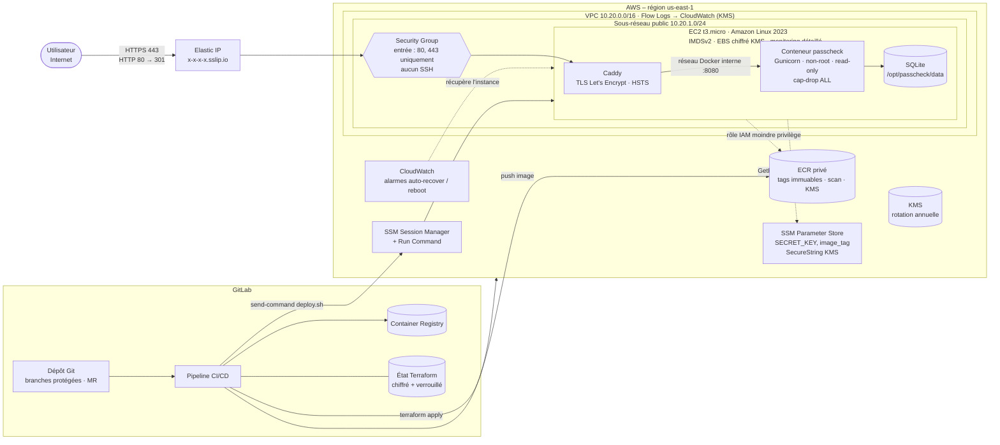

# PassCheck – Application Python sécurisée dans une pipeline DevSecOps

PassCheck est une application web Flask qui :

- vérifie si un mot de passe figure parmi les plus courants (listes SecLists) ;
- permet de créer un compte et de se connecter, avec **stockage sécurisé des mots de passe (Argon2id)**.

Elle est construite, testée, analysée et déployée sur **AWS** par une pipeline **GitLab CI/CD** dont chaque contrôle de sécurité est bloquant.

| | |
|---|---|
| URL de production | `https://<ip-avec-tirets>.sslip.io` (affichée par `terraform output app_url` et dans **Operate → Environments**) |
| Stack | Python 3.12 · Flask 3.1 · Gunicorn · SQLite · Docker · Caddy · Terraform · AWS (EC2, ECR, SSM, KMS, CloudWatch) |
| Équipe | voir [`CONTRIBUTING.md`](CONTRIBUTING.md) |

---

## 1. Architecture cible



### Choix d'architecture et justification

| Choix | Pourquoi |
|---|---|
| **EC2 + Docker** derrière **Caddy** | Simple et maîtrisé dans une sandbox. Caddy gère le **TLS automatique** (Let's Encrypt), la redirection HTTP → HTTPS et HSTS. |
| **sslip.io** | Nom de domaine gratuit dérivé de l'Elastic IP : il permet d'obtenir un vrai certificat TLS sans acheter de domaine. |
| **Aucun port SSH**, administration par **SSM Session Manager** | Surface d'attaque réduite, aucune clé SSH à gérer, chaque session est tracée dans CloudTrail. |
| **ECR + rôle IAM** pour tirer l'image | Aucun identifiant de registre stocké sur la machine : le rôle de l'instance suffit. |
| **Secrets dans SSM Parameter Store** (SecureString, KMS) | Ni dans le code, ni dans l'image, ni dans le *user data*. Ils sont lus au démarrage du conteneur. |
| **IMDSv2 obligatoire, hop limit 1** | Bloque le vol des credentials IAM par SSRF (scénario Capital One). Les conteneurs ne peuvent pas joindre l'IMDS. |
| **KMS dédié** (EBS, ECR, SSM, logs) avec rotation | Chiffrement au repos maîtrisé, et révocable. |
| **VPC Flow Logs** (rétention 1 an) | Détection et investigation d'incidents. |
| **État Terraform dans GitLab** | Chiffré, verrouillé pendant les `apply`, accessible selon les rôles. Pas de `.tfstate` dans Git. |
| **Compatibilité AWS Academy Learner Lab** (`use_lab_role = true`) | Le Learner Lab interdit `iam:CreateRole`. L'instance utilise donc `LabInstanceProfile`, et les Flow Logs `LabRole`. Les rôles au moindre privilège restent dans le code et sont créés automatiquement sur un vrai compte (`use_lab_role = false`). |
| **SQLite** sur volume hôte | Suffisant pour la charge du projet, sans coût ni service à exposer. *Limite :* il n'y a qu'une seule instance (voir §8). |

### Résilience

- **Redémarrage automatique** : `--restart unless-stopped` sur les conteneurs, et un `HEALTHCHECK` dans l'image.
- **Auto-recovery EC2** : une alarme CloudWatch sur `StatusCheckFailed_System` déclenche `ec2:recover`, et une autre sur `StatusCheckFailed_Instance` déclenche un reboot.
- **Redéploiement au démarrage** : un service systemd relance `deploy.sh`, qui récupère la version courante dans SSM.
- **Elastic IP** : l'URL reste la même si l'instance est recréée.
- **Infrastructure immuable** : toute l'infrastructure se recrée avec `terraform apply`, et chaque image est identifiée par le SHA de son commit. Un retour arrière consiste à redéployer un tag précédent.
- **Limites de ressources** sur les conteneurs (mémoire, CPU, PIDs) : une application défaillante ne peut pas faire tomber l'hôte.

---

## 2. Cycle de vie sécurisé (pipeline)

```mermaid
flowchart LR
    DEV[Développeur<br/>branche feature/*] -->|push| MR[Merge Request<br/>revue + approbation]
    MR --> L[lint<br/>flake8 · hadolint<br/>terraform validate<br/>intégrité wordlists]
    L --> S[security<br/>gitleaks · bandit · semgrep<br/>pip-audit · trivy fs · checkov]
    S --> T[test<br/>pytest 16 tests]
    T --> B[build<br/>image taggée SHA]
    B --> IT[image-test<br/>run durci · non-root<br/>health · headers]
    IT --> IS[image-scan<br/>trivy image · SBOM]
    IS -->|merge sur main| P[infra<br/>plan → apply manuel]
    P --> PUB[publish<br/>ECR immuable]
    PUB --> D[deploy<br/>SSM Run Command]
    D --> V[verify<br/>smoke test HTTPS<br/>DAST OWASP ZAP]
```



| Étape | Outil | Ce qui est vérifié | Bloquant |
|---|---|---|---|
| lint | flake8 | Qualité et syntaxe Python (PEP 8) | ✅ |
| lint | hadolint | Bonnes pratiques du Dockerfile | ✅ |
| lint | `sha256sum -c` | Intégrité des listes de mots de passe embarquées | ✅ |
| lint | `terraform validate` | Syntaxe et cohérence de l'IaC | ✅ |
| security | **gitleaks** | Secrets dans **tout l'historique** Git | ✅ |
| security | **bandit** | SAST spécifique à Python | ✅ |
| security | **semgrep** | SAST multi-règles (python, flask, secrets, dockerfile) | ✅ |
| security | **pip-audit** | CVE des dépendances Python (SCA) | ✅ |
| security | **trivy fs** | CVE et secrets dans le dépôt | ✅ HIGH/CRITICAL |
| security | **checkov** | Terraform, Dockerfile et `.gitlab-ci.yml` (IaC) | ✅ |
| test | **pytest** | 16 tests fonctionnels **et de sécurité** (CSRF, injection SQL, brute force, énumération, hachage…) | ✅ |
| build | docker | Image construite, taggée avec le **SHA du commit** et poussée dans le registry GitLab | ✅ |
| image-test | docker | L'image démarre **avec les restrictions de production** (read-only, cap-drop ALL, no-new-privileges), répond sur `/health`, tourne en UID 10001 | ✅ |
| image-scan | **trivy image** | CVE de l'image finale + génération du **SBOM CycloneDX** | ✅ HIGH/CRITICAL |
| infra | terraform | `plan`, puis `apply` **manuel** (validation humaine avant la production) | ✅ |
| publish | ECR | Copie de l'image testée vers ECR, tags **immuables** | ✅ |
| deploy | SSM | Mise à jour du tag dans SSM, puis `deploy.sh` exécuté par Run Command (sans SSH) | ✅ |
| verify | curl | Santé en HTTPS, HSTS, redirection HTTP → HTTPS | ✅ |
| verify | **OWASP ZAP** | **DAST** : scan passif de l'application en production | ✅ niveau FAIL |

**Principe de promotion :** c'est l'image **exacte** qui a passé les tests et les scans qui est déployée. On ne reconstruit jamais l'image entre le test et la production.

---

## 3. Sécurisation du code source

### Vulnérabilités de l'application d'origine (`_original_app/`)

| # | Constat | Détecté par | Risque | Correction |
|---|---|---|---|---|
| 1 | **Flask 2.2.2** : CVE-2023-30861 (PYSEC-2023-62, fuite de cookie de session via cache) et PYSEC-2026-2151 | pip-audit | Vol de session | Flask **3.1.3**, versions figées |
| 2 | `requests.get()` **sans timeout** (×2) | bandit **B113** | Déni de service | Plus aucun appel réseau à l'exécution (listes embarquées) |
| 3 | `app.run(host='0.0.0.0')` : **serveur de développement** exposé | bandit **B104** | Serveur non prévu pour la production | **Gunicorn** derrière Caddy, conteneur isolé |
| 4 | Recherche de **sous-chaîne** dans `str(bytes)` | revue de code | Faux positifs (« a » considéré comme faible) : contrôle non fiable | Comparaison **exacte** dans un `frozenset` |
| 5 | Listes téléchargées depuis la branche **`master`** à chaque requête | revue de code | Supply chain (contenu modifiable), panne si GitHub est indisponible, lenteur | Listes **figées sur un commit**, embarquées, **empreinte SHA-256 vérifiée en CI** |
| 6 | `requests` **absent** de `requirements.txt` | revue / test | L'application plante au premier POST (disponibilité) | Dépendance supprimée |
| 7 | `<input type="text">` pour le mot de passe | revue de code | Mot de passe visible à l'écran | `type="password"`, `autocomplete="off"` |
| 8 | Formulaire codé en dur sur `http://localhost:8080` | revue de code | Ne fonctionne pas en ligne, envoi **en clair** | URL relative `url_for()`, HTTPS seulement |
| 9 | **Aucune protection CSRF** | revue de code | Requêtes forgées depuis un autre site | **Flask-WTF CSRFProtect** sur tous les POST |
| 10 | Aucune limite de taille ni de débit | revue de code | DoS, brute force | `MAX_CONTENT_LENGTH` 16 Ko, **Flask-Limiter** (5/min sur login et inscription) |
| 11 | Aucun en-tête de sécurité | ZAP / revue | XSS, clickjacking, sniffing MIME | CSP stricte, X-Frame-Options, nosniff, Referrer-Policy, HSTS (Caddy) |
| 12 | 74 erreurs de style | flake8 | Code difficile à relire | Code conforme (0 erreur) |

### Mesures transverses

- **Configuration par variables d'environnement.** L'application **refuse de démarrer** en production si `SECRET_KEY` est absente.
- **Cookies de session** `Secure`, `HttpOnly` et `SameSite=Lax`, d'une durée de 30 minutes. La session est **régénérée à la connexion**, contre la fixation de session.
- **Requêtes SQL paramétrées** exclusivement. Un test vérifie que l'injection `' OR '1'='1` échoue.
- **Pages d'erreur génériques** : aucune trace d'erreur (*stack trace*) n'est exposée.
- **Le mot de passe n'est jamais journalisé ni renvoyé** dans une page (vérifié par un test).

---

## 4. Stockage sécurisé des mots de passe

| Mesure | Détail |
|---|---|
| **Argon2id** (`argon2-cffi`) | Algorithme recommandé par l'OWASP, l'ANSSI et la RFC 9106. Profil par défaut : t=3, m=64 Mio, p=4. Coûteux en mémoire, donc résistant aux attaques par GPU ou ASIC. |
| **Sel aléatoire** par mot de passe | Deux hachages du même mot de passe sont différents, ce qui rend les tables précalculées inutiles. |
| **Re-hachage automatique** | Si les paramètres sont renforcés, le hash est mis à jour à la connexion suivante (`check_needs_rehash`). |
| **Politique** (NIST SP 800-63B) | 12 caractères minimum et 128 maximum (anti-DoS). Interdiction des mots de passe présents dans les listes SecLists, et de ceux qui contiennent l'identifiant. |
| **Anti-énumération** | Message d'erreur identique, et **vérification d'un hash factice** quand le compte n'existe pas, pour que le temps de réponse soit le même. |
| **Anti brute force** | 5 tentatives par minute et par IP (vraie IP transmise par Caddy via `ProxyFix`). |
| **Base de données** | SQLite sur un volume chiffré (EBS KMS), répertoire en mode `0700` appartenant à l'UID 10001. |

Exemple de valeur stockée : `$argon2id$v=19$m=65536,t=3,p=4$<sel>$<hash>`. Le mot de passe en clair n'est jamais conservé.

---

## 5. Sécurité de l'image et de l'exécution

- **Build multi-stage**, base `python:3.12-slim-bookworm` (version figée), **sans outils de compilation** dans l'image finale.
- **Utilisateur non-root** (UID 10001, shell `nologin`). Le code appartient à root : l'application ne peut pas se modifier elle-même.
- **Exécution durcie** : `--read-only`, `/tmp` en tmpfs `noexec`, `--cap-drop ALL`, `no-new-privileges`, limites de mémoire, de CPU et de PIDs.
- **HEALTHCHECK** intégré à l'image, utilisé par la pipeline et par `deploy.sh`.
- **SBOM CycloneDX** produit à chaque build (artefact `sbom.cdx.json`).
- **ECR** : scan à la publication, tags **immuables**, cycle de vie limité aux 10 dernières images.

---

## 6. Gestion des secrets

| Secret | Où il est stocké | Qui y accède |
|---|---|---|
| Identifiants AWS de la sandbox | Variables CI/CD GitLab **Protected + Masked** | Jobs des branches protégées uniquement |
| `SECRET_KEY` Flask | SSM SecureString (KMS), générée par Terraform | Rôle IAM de l'instance |
| État Terraform | Backend HTTP GitLab (chiffré, verrouillé) | Maintainers |
| Jeton du registry GitLab | `CI_REGISTRY_PASSWORD`, éphémère, propre au job | Le job uniquement |

**Gitleaks analyse tout l'historique** à chaque pipeline. Le `.gitignore` exclut les fichiers `.env`, `*.tfstate`, `*.tfvars` et `*.db`.

---

## 7. Versioning et collaboration

Les règles complètes sont dans [`CONTRIBUTING.md`](CONTRIBUTING.md). En résumé :

- **GitLab Flow** : `main`, toujours déployable et **protégée** ; les branches `feature/*`, `fix/*` et `infra/*` se fusionnent par **Merge Request**.
- **Personne ne pousse directement sur `main`**, Maintainers compris. Une MR ne peut être fusionnée que si la **pipeline est verte**, après **revue par un autre membre**, et une fois tous les fils de discussion résolus.
- **Rôles GitLab au moindre privilège** : 1 Maintainer (configuration, variables, production), les autres en Developer. Pas d'Owner partagé.
- **CODEOWNERS** : `infra/`, `.gitlab-ci.yml` et `Dockerfile` exigent la revue du référent sécurité.
- **Commits** au format *Conventional Commits* (`feat:`, `fix:`, `sec:`…), **signés** (SSH ou GPG), et **releases** taguées en SemVer (`v1.2.0`).
- **2FA obligatoire** sur les comptes du groupe, et **jetons d'accès** avec une date d'expiration et une portée minimale.

---

## 8. Limites et améliorations prévues

| Limite actuelle | Amélioration |
|---|---|
| Une seule instance, dans une seule AZ | Auto Scaling Group sur 2 AZ derrière un **ALB + ACM + AWS WAF** |
| SQLite local | **RDS PostgreSQL** Multi-AZ en sous-réseau privé, chiffré, avec sauvegardes automatiques |
| Pas de sauvegarde automatique du volume | Politique **AWS Backup / DLM** (snapshot quotidien) |
| `LabRole` imposé par le Learner Lab : ses droits sont plus larges que notre rôle sur mesure | Sur un vrai compte : `use_lab_role = false`, qui active les rôles dédiés (ECR en lecture seule, 2 paramètres SSM, déchiffrement KMS) |
| Clés AWS de sandbox dans GitLab | Fédération **OIDC GitLab → AWS** (jetons éphémères, aucune clé stockée) |
| Images de base figées par tag | Épinglage par **digest** + mises à jour automatiques (Renovate) |
| Images non signées | Signature **Cosign** et vérification au déploiement |
| Limiteur de débit en mémoire (par worker) | Stockage Redis partagé |

---

## 9. Mise en route

### Prérequis (une seule fois, par le Maintainer)

1. **Settings → CI/CD → Variables**, chacune en **Protected** et **Masked** : `AWS_ACCESS_KEY_ID`, `AWS_SECRET_ACCESS_KEY`, `AWS_SESSION_TOKEN`, `AWS_DEFAULT_REGION` (par exemple `us-east-1`). Les identifiants de sandbox expirent : il faut les mettre à jour à chaque nouvelle session.
2. **Settings → Repository → Protected branches** : `main`, avec *Allowed to push* = **No one** et *Allowed to merge* = Maintainers + Developers.
3. **Settings → Merge requests** : cocher *Pipelines must succeed* et *All threads must be resolved*.

### Développement local

```bash
python3 -m venv .venv && source .venv/bin/activate
pip install -r requirements-dev.txt
APP_ENV=development DB_PATH=./dev.db flask --app "app.main:create_app()" run --port 8080
python -m pytest
```

### Avec Docker

```bash
docker build -t passcheck .
docker run --rm -p 8080:8080 --read-only --tmpfs /tmp --cap-drop ALL \
  -e SECRET_KEY="$(openssl rand -hex 32)" -e APP_ENV=development passcheck
```

### Déploiement

1. Fusionner une MR sur `main`.
2. Dans la pipeline, lancer le job manuel **`infra_apply`**. La publication, le déploiement, le smoke test et le DAST s'enchaînent ensuite automatiquement.
3. L'URL s'affiche dans **Operate → Environments → production**.
4. En fin de session de sandbox, lancer le job manuel **`infra_destroy`**.

---

## 10. Correspondance avec les référentiels

| Référentiel | Couverture |
|---|---|
| **OWASP Top 10 2021** | A01 (contrôle d'accès, session), A02 (Argon2id, TLS, KMS), A03 (SQL paramétré, CSP), A05 (durcissement, en-têtes), A06 (SCA), A07 (anti brute force, anti-énumération), A08 (intégrité des listes, images immuables), A09 (Flow Logs, logs applicatifs) |
| **ANSSI** | Recommandations sur les mots de passe et le stockage (Argon2), durcissement des conteneurs Docker, administration sans SSH |
| **CIS Benchmarks** | Docker (non-root, read-only, capabilities), AWS Foundations (IMDSv2, chiffrement, Flow Logs) |
| **NIS 2, art. 21** | Sécurité de la chaîne d'approvisionnement (SCA, SBOM, versions figées), gestion des vulnérabilités, chiffrement, contrôle d'accès |
